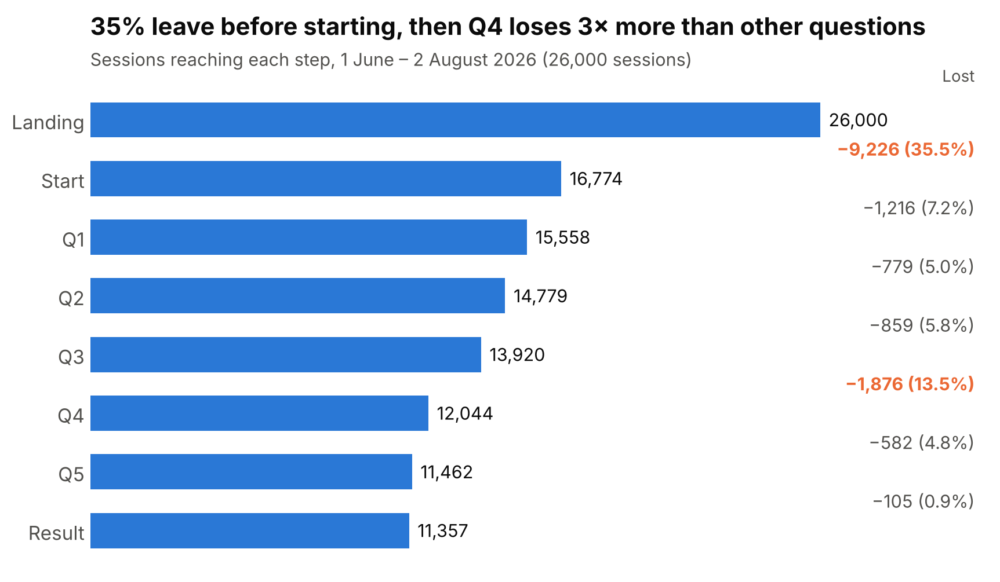
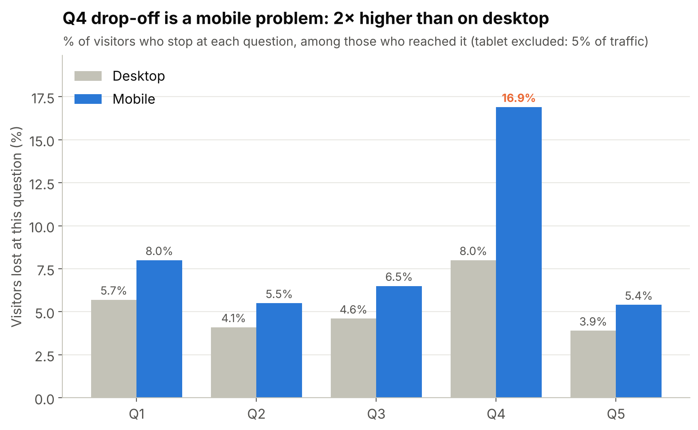
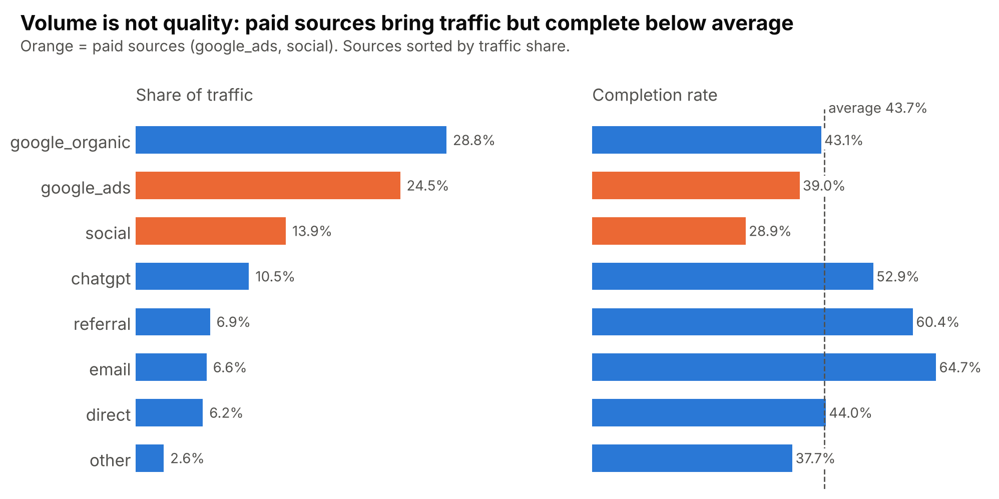
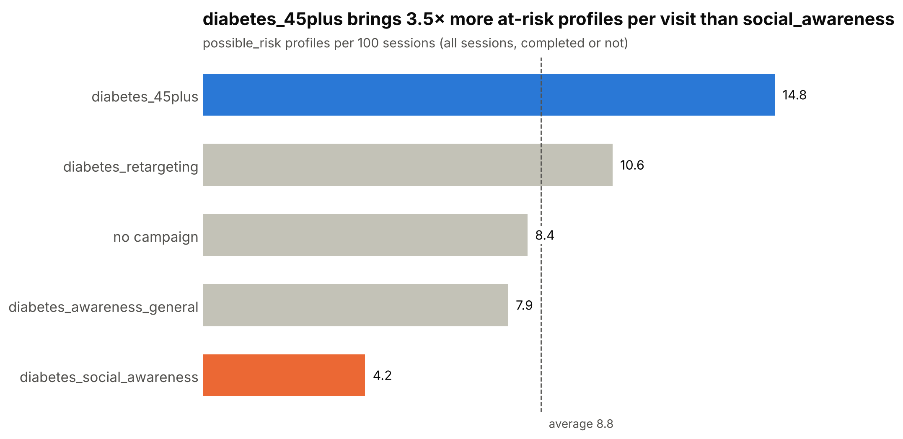
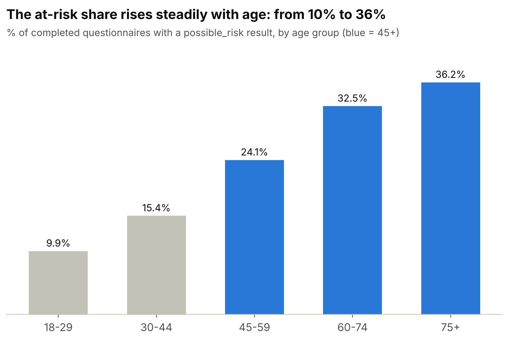
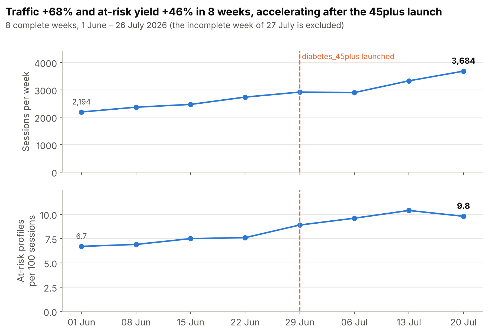

# Project documentation: Type 2 Diabetes Questionnaire (Doctoome)

This document explains, phase by phase, **what was done**, **what was observed** and **what was decided**.

- **Data:** 6 synthetic Parquet files (`data/`)
- **Tools:** Python, DuckDB (SQL), pandas, matplotlib
- **Code:** `notebook/analysis.ipynb` and `sql/02_clean_tables.sql`
- **Charts:** `outputs/figures/`

> The data is synthetic. Outcome categories are **analytical categories**, not medical diagnoses.

---

# Phase 1: Data exploration and understanding

**Goal:** understand what the data contains and detect issues, **without changing anything**.

## 1.1 Discovering the tables

**What was done:** count the rows, inspect columns and types, and display a few rows of each table.

**What was observed:**

| Table | Rows | Content |
|---|---|---|
| visitors | 20,000 | Visitors: age, gender, region |
| sessions | 26,000 | Visits: source, campaign, device |
| questions | 5 | The 5 questions of the questionnaire |
| events | 195,816 | Actions: landing, start, view, answer, completion |
| answers | 68,460 | Answers |
| outcomes | 11,357 | Results of completed questionnaires |

**Findings:**
- Column types are correct: no conversion is needed.
- There are about 1.3 sessions per visitor: some visitors come back.
- The journey is clear: landing → start → 5 questions → result.
- Timestamps are displayed in **UTC**. Without this setting, DuckDB displayed them in Paris time and some sessions moved to another day.

## 1.2 Spotting suspicious columns

**What was done:** a profile of each column (min, max, number of distinct values, % missing), then an exact count of the values of suspicious columns.

**Findings:**
- **Gender** coded several ways: `female`, `F`, `Female`, `male`, `M`, `Male`.
- **Region** inconsistently written: lowercase, missing accents or hyphens (`bretagne`, `Ile de France`…). Only 9 regions exist in the data.
- **Source** written several ways: `google` and `Google`, `facebook` and `instagram` next to `social`, `ChatGPT` and `AI Assistant` next to `chatgpt`.
- **Missing values:** gender (653), region (804), birth year (761).
- **Ages from 16 to 97**: there are 42 minors.
- **Campaign empty for 54% of sessions:** expected, free channels have no campaign.
- DuckDB's statistical profile gives **approximate** distinct counts, so every suspicion was checked with an exact count.

## 1.3 Checking source / campaign consistency

**What was done:** cross-tabulate each source with its campaign.

**Findings:**
- The 900 `google` / `Google` sessions have **no campaign**, while **every** `google_ads` session has one. They are therefore organic visits.
- All paid channels do have a campaign: paid attribution is reliable.
- **219 "direct" sessions carry a campaign**, which is not logical.

## 1.4 Looking for duplicates

**What was done:** check that every ID is unique and that a session has only one answer per question.

**Findings:**
- All IDs are unique.
- **697 times, a session answered the same question twice**, with 2 different values about 10 seconds apart. This is not a bug: the visitor **changed their answer**.
- 1,043 questions were viewed twice: visitors going back, which is normal behaviour.

## 1.5 Checking the questionnaire logic

**What was done:** check that answers are allowed, that every completed questionnaire has 5 answers and an outcome, that tables are correctly linked, and that timestamps are in the right order.

**Findings:**
- All answers are allowed for their question.
- Every completed questionnaire has 5 answers, a completion event and an outcome.
- No broken link between tables and no timestamp in the wrong order.
- The "returning visitor" flag is correct.
- **105 sessions answered all 5 questions but have no outcome:** either they left just before the result, or a tracking bug.

## 1.6 Checking the period

**What was done:** count sessions per day at the end of the period.

**Findings:**
- The brief announces June–August, but **the data stops on 2 August at 16:44 UTC**.
- 1 August is already abnormally low (406 sessions instead of ~550 per day).
- **The real period is therefore 1 June – 2 August 2026.** No conclusion can be drawn about August.

## 1.7 Issues retained and decisions

| # | Issue | Volume | Decision |
|---|---|---|---|
| 1 | Data stops on 2 August | 626 sessions (1–2 Aug) | Kept, but time trends stop at 31 July |
| 2 | Gender coded several ways | 993 visitors | Harmonised to `female` / `male` |
| 3 | Region inconsistently written | 868 visitors | Mapped to the official name |
| 4 | Source written several ways | 1,670 sessions | Regrouped (google → google_organic, etc.) |
| 5 | Missing values (gender, region, age) | 653 / 804 / 761 | Kept as `unknown` |
| 6 | Two answers to the same question | 697 cases | Latest answer kept |
| 7 | 5 answers but no outcome | 105 sessions | Counted as not completed, flagged |
| 8 | "Direct" sessions with a campaign | 219 sessions | Kept, flagged |

---

# Phase 2: Data cleaning

**Goal:** apply the phase 1 decisions and build **clean tables**.
The original files are **never modified**: new tables are created in DuckDB by `sql/02_clean_tables.sql`.

**Rule:** suspicious rows are not deleted; they get a **flag** (a true/false column), so they can be counted or excluded depending on the analysis.

## 2.1 Cleaning visitors → `visitors_clean`

**What was done:**
- harmonised gender (`F`, `Female` → `female`; `M`, `Male` → `male`);
- mapped regions to their official name;
- replaced missing values with `unknown`;
- computed **age** and an **age group** (`<18`, `18-29`, `30-44`, `45-59`, `60-74`, `75+`). The 45 cut-off makes it possible to evaluate the `diabetes_45plus` campaign.

**Check:** 20,000 visitors before and after. female = 9,803 and male = 8,748, matching the sum of the variants.

## 2.2 Cleaning sessions → `sessions_clean`

**What was done:**
- regrouped sources according to the phase 1 decisions;
- replaced empty campaigns with `none`;
- kept the original source in a separate column for traceability;
- added the day and week of the session, for time trends;
- added 2 flags: "direct with campaign" (219) and "1–2 August" (626).

**Check:** 26,000 sessions. google_organic = 7,490, social = 3,618, chatgpt = 2,729.

## 2.3 Cleaning answers → `answers_clean`

**What was done:**
- for the 697 duplicate answers, kept **the most recent** one (with `ROW_NUMBER`);
- added a "changed answer" flag.

**Check:** 68,460 − 697 = 67,763 answers, all unique.

## 2.4 Building the analysis table → `session_summary`

**What was done:** a table with **one row per session**, combining:
- where the session comes from (source, campaign, device);
- who the visitor is (age, gender, region);
- how far they went (start, number of questions answered);
- their outcome and the questionnaire duration.

Every phase 3 analysis starts from this table.

**Check:** 26,000 sessions (none lost), 16,774 started, 11,357 completed.

## 2.5 Added columns and why they are useful

### `age` and `age_group`
- **What it is:** age (2026 − birth year) and the matching age group. For example, born in 1980 → 46 → `45-59`.
- **Why groups:** with 70 different ages a chart is unreadable; with 6 groups trends are immediately visible.
- **Why a 45 cut-off:** Doctoome runs a `diabetes_45plus` campaign. This cut-off makes it possible to check whether the campaign reaches its target.
- **`<18`** groups minors (42 people, to be flagged). **`unknown`** groups visitors without a birth year (761), who are kept.

### `session_week`
- **What it is:** the session date brought back to the **Monday of its week**. For example, a session on Wednesday 10 June → Monday 8 June.
- **Why:** to build **weekly trends**, more readable than a daily curve, which is too irregular.

### `acquisition_source_raw`
- **What it is:** the **original** source, before correction. For example, `Google` corrected to `google_organic`.
- **Why:** **traceability**. Any corrected value can be traced back, and the original information is never lost.

### Flags (true/false columns)
A flag is a **label** on a specific row. Nothing is deleted, but rows can be filtered when relevant.

| Flag | True when… | Why | Use |
|---|---|---|---|
| `flag_direct_with_campaign` (219) | the session is "direct" **and** has a campaign | Illogical: a direct visit does not come from an ad. We cannot know which information is true. | Check that these sessions do not change the campaign conclusions |
| `flag_incomplete_period` (626) | the session took place on 1 or 2 August | Data stops on 2 August. Without excluding them, the curve would drop at the end and suggest a traffic decline. | Excluded from time trends, kept elsewhere |
| `flag_answer_changed` (697) | the visitor answered the same question twice | The latest answer is kept; this flag keeps the "hesitation" information. | Spot questions that cause hesitation (possibly badly worded) |
| `flag_5_answers_no_outcome` (105) | 5 answers but no outcome | Left just before the result, or tracking bug | Counted as not completed; tracking recommendation |

### `completion_seconds`
- **What it is:** time between the click on "start" and the result. For example, from 10:00:00 to 10:01:38 → 98 seconds.
- **Why:** to know whether the questionnaire is long. The median is **98 seconds**: it is short, so drop-offs come from specific questions rather than from its length.
- **Note:** the column is empty for questionnaires that were not completed.

### Summary

| Column | Used to… |
|---|---|
| `age`, `age_group` | Compare by age, evaluate the 45+ campaign |
| `session_week` | Build weekly trends |
| `acquisition_source_raw` | Keep the original value |
| `flag_...` | Label specific rows without deleting them |
| `completion_seconds` | Measure questionnaire duration |

## 2.6 What cleaning already reveals

- **google_organic is the #1 source** (7,490 sessions), ahead of google_ads (6,375).
- **About 10% of traffic comes from AI assistants** (chatgpt).
- **The questionnaire takes about 1 min 40 s** (median: 98 seconds).
- **35% of visitors leave without starting** the questionnaire.
- **Question 4 (physical activity) is where most visitors drop off.**

---

# Phase 3: Analyses

**Goal:** answer Doctoome's business questions using the clean tables.
Every analysis starts from **`session_summary`** (one row per session).

**The 4 main questions:**

| # | Analysis | Business question | Why it matters |
|---|---|---|---|
| 1 | Funnel | Where do we lose visitors? | Know **what to improve** in the page and the questionnaire |
| 2 | Acquisition | Which channels bring visitors who complete? | Know **where to spend** the marketing budget |
| 3 | Outcomes | Who gets a `possible_risk` result? | Identify the channels that reach **Doctoome's target** |
| 4 | Trends | How does performance evolve? | Spot **trends** and **campaign effects** |

**Method for each step:** business question → computation (SQL, pandas for formatting) → result → interpretation → conclusion.

---

## Analysis 1: The funnel

### What is a funnel?
A **funnel** represents the visitor journey, step by step. Many people enter at the top, and at each step some leave. We measure how many visitors remain at each step to find **where we lose the most people**.

Doctoome's journey has 8 steps:
**Landing → Start → Q1 → Q2 → Q3 → Q4 → Q5 → Result**

Two rates are computed:
- the **step rate** = sessions at the step ÷ sessions at the **previous** step. It shows **where it breaks**;
- the **overall rate** = sessions at the step ÷ sessions **at the start**. It shows **how many are left**.

### Step 20: Overall funnel

**How it was computed:** for each step, count the sessions that reached it. A session with at least 3 answers is counted as having reached Q3 (`nb_questions_answered >= 3`). Rates are then computed with pandas (`shift(1)` to compare with the previous step).

**Result:**

| Step | Sessions | % of start | Step rate | Lost |
|---|---|---|---|---|
| Landing | 26,000 | 100% | — | — |
| Start | 16,774 | 64.5% | **64.5%** | **9,226** |
| Q1 | 15,558 | 59.8% | 92.8% | 1,216 |
| Q2 | 14,779 | 56.8% | 95.0% | 779 |
| Q3 | 13,920 | 53.5% | 94.2% | 859 |
| Q4 | 12,044 | 46.3% | **86.5%** | **1,876** |
| Q5 | 11,462 | 44.1% | 95.2% | 582 |
| Result | 11,357 | 43.7% | 99.1% | 105 |

**Interpretation:**
- At a "normal" step, about **5%** of visitors leave. A step clearly above that level signals a problem.
- **The landing page is the biggest leak:** 35% of visitors leave without clicking "start". This is **63% of all lost visitors** (9,226 out of 14,643). The problem lies **before** the questionnaire: the page message, the button, trust, loading time.
- **Q4 is the question that drives people away:** 13.5% drop-off, almost 3× more than the other questions. It is the physical activity question, the only one with 4 options, and potentially uncomfortable ("rarely_or_never").
- **Between start and Q1, 7.2% leave:** they click "start" without answering the first question. Q1 is directly about a medical diagnosis (a sensitive topic), or there is a display issue.
- Once Q5 is reached, 99% see their result.

**Conclusion:** out of 100 visitors, 44 reach the result. 35 are lost before they even start, and Q4 loses 3× more people than the other questions.

### Step 21: Funnel by device

**Why:** to know whether the leaks are the same on every device. If a question loses people mainly on mobile, the problem is probably the **display** rather than the **content**.

**How it was computed:** same logic as step 20, with `GROUP BY device_type`: one funnel per device.

**Result:**

| Device | Traffic share | Landing→Start | Q3→Q4 | Overall completion |
|---|---|---|---|---|
| Mobile | **65%** | 62.7% | **83.1%** | **39.7%** |
| Desktop | 30% | 68.5% | 92.0% | 51.8% |
| Tablet | 5% | 64.0% | 91.8% | 45.8% |

**Interpretation:**
- Mobile is slightly worse at every step (1 to 2 points), which is normal: people are more easily distracted on a phone.
- **But at Q4 the gap explodes:** 17% drop-off on mobile vs 8% on desktop, **2× more**.
- If Q4 were only uncomfortable, it would lose as many people on every device. Since the problem is **concentrated on mobile**, the most likely cause is **the display**: 4 options with long labels on a small screen.
- Even on desktop, Q4 loses slightly more than the other questions (8% vs ~4%): there is also a small content effect.

**Conclusion:** two thirds of visitors are on mobile, and they complete 12 points less than on desktop, mainly because of Q4. **Recommendation:** redesign Q4 for mobile. If mobile matched desktop at this question, about **700 more results** would be obtained over the period (+6%).

---

## Analysis 2: Acquisition

### Step 22: Performance by source

**Why:** a source can bring many people who leave right away. **Volume is not quality.**

**How it was computed:**
- `COUNT(*)` gives sessions per source;
- `SUM(COUNT(*)) OVER ()` gives the grand total, to compute the **traffic share**;
- `AVG(is_completed::INT)` gives the **completion rate** (the average of a 0/1 column is directly a percentage).

**Result (overall average: 43.7% completion):**

| Source | Traffic share | Start rate | Completion rate |
|---|---|---|---|
| google_organic | 28.8% | 63.3% | 43.1% |
| google_ads | 24.5% | 60.2% | 39.0% |
| social | 13.9% | 51.4% | **28.9%** |
| chatgpt | 10.5% | 74.7% | 52.9% |
| referral | 6.9% | 80.0% | 60.4% |
| email | 6.6% | 84.0% | **64.7%** |
| direct | 6.2% | 64.7% | 44.0% |
| other | 2.6% | 56.8% | 37.7% |

**Interpretation:**
- **The best sources are small:** email, referral and chatgpt. These visitors know why they come (an email received, a recommendation, advice from an AI assistant): they are motivated.
- **Paid sources perform below average:** google_ads (39%) and especially social (29%, the worst). Together they represent 38% of traffic but only 31% of results.
- On social, half of the visitors do not even click "start": they arrive out of curiosity while scrolling, and leave.

**Limitation:** campaign costs are not available, so the **cost per result** cannot be computed.

### Step 23: Performance by campaign

**Why:** compare the 4 paid campaigns and check that `diabetes_45plus` really reaches people aged 45+.

**How it was computed:** completion rate per campaign, and share of visitors aged 45+ (`AVG((age >= 45)::INT)`). The `none` row (sessions without a campaign) is the **baseline**.

**Result:**

| Campaign | Sessions | Completion | Aged 45+ |
|---|---|---|---|
| none (no campaign) | 14,081 | 46.9% | 45.0% |
| awareness_general | 3,422 | 45.4% | 44.9% |
| social_awareness | 3,345 | **28.5%** | **19.4%** |
| **45plus** | 3,337 | 37.5% | **90.6%** |
| retargeting | 1,815 | **54.8%** | 46.8% |

**Interpretation:**
- **45plus targets very well:** 90.6% aged 45+, vs 45% naturally, i.e. 2× more. But it completes little (37.5%).
- **social_awareness is the weakest:** low completion **and** a young audience (19% aged 45+), whereas type 2 diabetes mostly affects older people.
- **retargeting has the best completion:** it targets people who already visited and come back to finish.

---

## Analysis 3: Questionnaire outcomes

> Reminder: categories are **analytical and fictional**, not medical diagnoses.

### Step 24: Outcome distribution

**Result (11,357 completed questionnaires):**

| Outcome | Count | Share |
|---|---|---|
| no_current_indication | 7,841 | 69% |
| **possible_risk** | **2,276** | **20%** |
| declared_diagnosed | 1,240 | 11% |

**Interpretation:**
- **1 in 5 completers gets a `possible_risk` result.** These are the people to whom Doctoome can offer a consultation: this is **the real business value** of the page.
- **11% declare a previous diagnosis:** a **follow-up** need rather than screening, i.e. another possible offer.

### Step 25: Who gets `possible_risk`?

**How it was computed:** a **reusable Python function** (`possible_risk_share(dimension)`), applied to age, source and campaign. The query is written once instead of three times.

**By age:**

| Age | 18-29 | 30-44 | 45-59 | 60-74 | 75+ |
|---|---|---|---|---|---|
| possible_risk share | 9.9% | 15.4% | 24.1% | 32.5% | **36.2%** |

→ Risk **rises steadily with age** (3.5× more among 75+ than among 18-29). This is consistent with what is known about type 2 diabetes, which makes the data credible. Under-18s (28 results) are too few to conclude.

**By campaign:** 45plus reaches **39.5%** possible_risk, 2× the average. It completes little, but **those who complete are far more often in the target group**.

**By source:** google_ads reaches **29%** possible_risk and brings **the largest number of at-risk profiles (723)**, thanks to the 45plus campaign. Conversely, chatgpt completes well but only 14% of its completers are at risk.

**Interpretation:** the completion rate **alone** is not enough to judge a channel. A channel can have many completers but few relevant profiles.

### Step 26: The key metric, "at-risk profiles per 100 sessions"

**Why:** two figures contradicted each other (completion and risk share). **A single metric** was needed to rank channels. It answers Doctoome's real question: *"if I bring 100 people through this channel, how many at-risk profiles do I get in the end?"*

It combines both losses: visitors who do not complete count as 0, and completers who are not at risk also count as 0.

**Example:**
- chatgpt: 100 sessions → 53 complete → 14% at risk → **7.5 at-risk profiles**;
- google_ads: 100 sessions → 39 complete → 29% at risk → **11.3 at-risk profiles**.

**Technical point (SQL pitfall):** for a session without a result, `outcome_category` is empty (`NULL`), and `AVG` **ignores** `NULL`s. Without a fix, the division was only over completed sessions. `COALESCE(..., FALSE)` makes sessions without a result count as 0.

**Result (overall average: 8.8 per 100 sessions):**

| Source | Per 100 sessions | | Campaign | Per 100 sessions |
|---|---|---|---|---|
| referral | 12.5 | | **45plus** | **14.8** |
| email | 11.4 | | retargeting | 10.6 |
| google_ads | 11.3 | | none | 8.4 |
| direct | 8.3 | | awareness_general | 7.9 |
| google_organic | 7.9 | | **social_awareness** | **4.2** |
| chatgpt | 7.5 | | | |
| other | 7.3 | | | |
| **social** | **4.3** | | | |

**Conclusion:** **45plus is the best channel** (14.8, i.e. 1.7× the average). **social_awareness is the worst** (4.2), 3.5× less efficient than 45plus. **Recommendation: shift budget from social_awareness to 45plus.**

---

## Analysis 4: Trends over time

### Step 27: Weekly trend

**Methodological choice:** only the **8 complete weeks** are kept (1 June → 26 July). The week of 27 July is incomplete because the data stops on 2 August: keeping it would have created a false decline.

**Result:**

| Week | Sessions | Completion | At-risk profiles per 100 sessions | Mobile share |
|---|---|---|---|---|
| 1 June | 2,194 | 40.0% | 6.7 | 64.9% |
| 8 June | 2,369 | 41.5% | 6.9 | 63.6% |
| 15 June | 2,470 | 41.6% | 7.5 | 64.5% |
| 22 June | 2,737 | 43.2% | 7.6 | 63.4% |
| 29 June | 2,920 | 43.3% | 8.9 | 65.3% |
| 6 July | 2,902 | 43.6% | 9.6 | 64.3% |
| 13 July | 3,331 | 45.2% | 10.4 | 66.3% |
| 20 July | 3,684 | 47.1% | 9.8 | 64.9% |

**Interpretation:**
- **Traffic grows by 68%** in 8 weeks, accelerating in mid-July.
- **Quality improves at the same time:** completion +7 points, at-risk profiles +46%. This is unusual: more traffic usually means less motivated visitors.
- **Mobile share stays stable** (~65%): the improvement does not come from devices.

### Step 28: Campaign mix over time

**Why:** understand **where** the step 27 improvement comes from.

**How it was computed:** a **pandas pivot table** (`pivot_table`) with weeks as rows and campaigns as columns. Each row is then converted to percentages so that it sums to 100%.

**Result (share of the week's sessions):**

| Week | 45plus | retargeting | social_awareness | awareness_general | no campaign |
|---|---|---|---|---|---|
| 1 June | 0% | 0% | 17.1% | 19.0% | 63.9% |
| 22 June | 0% | 6.3% | 14.5% | 18.3% | 60.9% |
| **29 June** | **12.7%** | 5.8% | 13.7% | 13.2% | 54.7% |
| 6 July | 24.5% | 7.3% | 10.6% | 8.1% | 49.6% |
| 20 July | 21.1% | 11.7% | 9.6% | 9.7% | 47.9% |

**Interpretation:**
- **45plus is launched the week of 29 June** and grows to about 22% of sessions.
- **retargeting grows progressively** up to 12%.
- **Weaker campaigns decline:** social_awareness falls from 17% to 10%.
- **The rise in at-risk profiles coincides exactly with the 45plus launch** (7.6 → 8.9 → 10.4 per 100 sessions).

**Conclusion:** the improvement is largely explained by the **change in marketing mix**: the July strategy worked.
**Caveat:** this is a **correlation**, not a proof. Other changes (e.g. a page improvement) may have contributed. Only an **A/B test** could prove it.

---

## Phase 3 summary

| Analysis | Key message | Recommendation |
|---|---|---|
| **Funnel** | 35% leave from the landing page; Q4 loses 3× more than other questions, mostly on mobile | Rework the landing page; redesign Q4 for mobile |
| **Acquisition** | Volume is not quality: email, referral and chatgpt complete best; social the least | Judge channels on quality, not volume |
| **Outcomes** | 1 in 5 is `possible_risk`; risk rises with age; 45plus brings 14.8 at-risk profiles per 100 sessions vs 4.2 for social_awareness | Shift budget from social_awareness to 45plus |
| **Trends** | Traffic +68% and quality up since the 45plus launch | Keep this direction; validate with an A/B test |

---

# Phase 4: Visualisations

**Goal:** turn the phase 3 results into charts that an executive audience (C-level) can read, used directly in the slides.

**Where:** steps 29 to 35 of the notebook. Images are saved in `outputs/figures/`.

## 4.1 Principles

| Principle | Why |
|---|---|
| **One chart = one idea** | An executive must get the message in a few seconds |
| **The title states the conclusion**, not the topic ("Q4 loses 3× more", not "funnel analysis") | The reader keeps the message even without reading the details |
| **Blue for data, orange only for what must stand out**, grey for context | The eye goes straight to the problem or the key result |
| **Values written on the bars** rather than a graduated axis | No need to "read" the axis to get the number |
| **A dashed line for the average** when comparing | Above / below average is immediately visible |
| **Never two y-axes on the same chart** | Two different scales can make curves "cross" anywhere, which misleads the reader; two separate panels are used instead |

**Code organisation:** a shared settings cell (step 29) defines colours, style and two reusable functions: `add_title()` (title + subtitle) and `save()` (high-quality PNG export). Each chart reuses the tables already computed in phase 3, so queries are not repeated.

## 4.2 Chart 1: the funnel

- **What it shows:** the number of sessions still present at each step (horizontal bars), and the loss since the previous step (right column).
- **How it is built:** horizontal bars (`barh`) from the step 20 `funnel` table; losses above 10% are written in bold orange.
- **Interpretation:** two leaks stand out: **the landing page (−35.5%)**, which accounts for 63% of all lost visitors, and **Q4 (−13.5%)**, while other steps lose about 5%.
- **What to do:** priority 1, convince visitors to start; priority 2, fix Q4.

## 4.3 Chart 2: drop-off by question, mobile vs desktop

- **What it shows:** for each question, the % of visitors who stop there among those who reached it, on desktop (grey) and mobile (blue).
- **How it is built:** grouped bars; drop-off rate = 100 − step rate, computed in SQL by device. Tablet (5% of traffic) is excluded to keep the chart readable.
- **Interpretation:** mobile loses slightly more at every question (+1 to +2 points), but **at Q4 the gap doubles: 16.9% vs 8.0%**. If the question were only uncomfortable, it would lose as many people on both devices: the most likely cause is **how Q4 renders on small screens** (the only question with 4 options and long labels).
- **What to do:** redesign Q4 for mobile. Estimated gain: ~700 more results over the period (+6%).

## 4.4 Chart 3: volume vs completion by source

- **What it shows:** on the left each source's traffic share, on the right its completion rate, with sources in the same order.
- **How it is built:** two side-by-side panels sharing the source axis (`sharey=True`); paid sources (google_ads, social) in orange; dashed line = average (43.7%).
- **Interpretation:** the big paid sources complete below average (**google_ads 39.0%, social 28.9%**), while small sources complete best (**email 64.7%, referral 60.4%, chatgpt 52.9%**).
- **What to do:** do not judge a channel on traffic alone.

## 4.5 Chart 4: at-risk profiles per 100 sessions, by campaign

- **What it shows:** for 100 sessions brought by each campaign, how many end with a `possible_risk` result.
- **How it is built:** reuses the `risk_per_100()` function from step 26; best campaign in blue, worst in orange, the others in grey; dashed line = average (8.8).
- **Interpretation:** **diabetes_45plus: 14.8**, 1.7× the average; **diabetes_social_awareness: 4.2**, i.e. 3.5× less than 45plus. This metric combines both losses (those who do not complete, and completers who are not at risk).
- **What to do:** shift budget from social_awareness to 45plus (to be confirmed with campaign costs).

## 4.6 Chart 5: at-risk profiles by age group

- **What it shows:** among completed questionnaires, the % of `possible_risk` results by age group.
- **How it is built:** reuses the `possible_risk_share()` function from step 25; 45+ in blue (target of the 45plus campaign); under-18s (28 results) and unknown ages are excluded.
- **Interpretation:** the share rises steadily with age: **9.9% (18–29) → 36.2% (75+)**. This is consistent with type 2 diabetes, which makes the data credible, and it **explains chart 4**: targeting people aged 45+ mechanically brings more at-risk profiles.

## 4.7 Chart 6: weekly trend

- **What it shows:** top, sessions per week; bottom, at-risk profiles per 100 sessions; the orange line marks the first week of diabetes_45plus (29 June).
- **How it is built:** two stacked panels sharing the week axis (`sharex=True`), from the step 27 `weekly` table; only the 8 complete weeks.
- **Interpretation:** **traffic +68%** (2,194 → 3,684 sessions/week) and **at-risk profiles +46%** (6.7 → 9.8). The quality jump starts the week 45plus is launched. More traffic usually means less engaged visitors; here both improve.
- **Caution:** this is a correlation in time, not a proof; an A/B test would be needed to confirm it.

## 4.8 Why not more charts?

- **Data quality** is better presented as a **table** (issue, rows affected, decision).
- **The outcome distribution** (69% / 20% / 11%) speaks more clearly as **three big numbers** than as a pie chart.
- Six charts means one per key message: enough for 15 minutes without overwhelming the audience.

---

# Phase 5: Answers to the four questions

## 1. What are the most important findings?

1. **The landing page is the biggest leak: 35% of visitors leave without starting the questionnaire.** This represents 63% of all lost visitors. Overall, 43.7% of visitors reach a result (67.7% of those who start).
2. **Q4 (physical activity) is the main drop-off inside the questionnaire, and it is mostly a mobile problem.** 13.5% of visitors stop at Q4 vs ~5% at the other questions; on mobile it reaches 16.9% vs 8.0% on desktop. Mobile is 65% of traffic: fixing Q4 on mobile would add ~700 results over the period (+6%).
3. **Volume is not quality.** Paid sources bring the most traffic but complete below average (google_ads 39.0%, social 28.9%), while small sources complete best (email 64.7%, referral 60.4%, chatgpt 52.9%).
4. **The right metric is at-risk profiles per 100 sessions, and diabetes_45plus wins by far.** 1 in 5 completers gets `possible_risk`, and this share rises with age (9.9% → 36.2%). diabetes_45plus brings 14.8 at-risk profiles per 100 sessions vs 4.2 for diabetes_social_awareness (average 8.8).
5. **Performance improved over the period.** Traffic +68% and at-risk yield +46% in 8 weeks; the jump coincides with the launch of diabetes_45plus (week of 29 June) and the decline of social_awareness.
6. **The data is reliable after cleaning, with one major limit:** it only covers 1 June – 2 August 2026, not June–August.

## 2. Which questions remain unanswered?

- **Why do 35% of visitors leave the landing page?** There is no data on load time, scroll depth or time spent on the page.
- **Is the Q4 drop-off really a mobile display issue?** The device gap strongly suggests it, but only a UX review or an A/B test of a redesigned Q4 can confirm it.
- **Did diabetes_45plus cause the quality improvement?** It is a correlation in time; other changes (page, seasonality) may have happened at the same time.
- **What happens after the result?** We do not know whether `possible_risk` visitors book a consultation, which is the real business outcome for Doctoome.
- **Which channels are the most cost-efficient?** Without campaign costs, no cost per completion or per at-risk profile can be computed.
- **Why does the data stop on 2 August, with 1 August already abnormally low?** Extraction limit or tracking incident?
- **Are some attributions wrong?** 219 `direct` sessions carry a campaign, `other` is undefined, and 105 sessions answered all 5 questions without an outcome (abandonment or tracking bug).

## 3. What additional data would you collect?

| Data | Why |
|---|---|
| **Post-result actions**: click on "book a consultation", appointment booked, consultation held | Measure the real business conversion, especially for `possible_risk` profiles |
| **Campaign costs** (spend, impressions, clicks) | Compute cost per completion and per at-risk profile for each channel |
| **Landing page behaviour**: load time, scroll depth, time on page, clicks on the start button, errors | Understand the 35% who leave before starting |
| **Questionnaire UX**: screen size, browser, "back" clicks, time per question | Confirm the mobile display hypothesis for Q4 |
| **Questionnaire / page version ID** | Run and analyse A/B tests properly |
| **Full UTM parameters** (source, medium, campaign, content, term) and referrer | Remove attribution ambiguities (`google`, `direct` with campaign, `other`, AI assistants) |
| **The complete August data** + tracking completeness logs | Analyse the full period and detect tracking incidents |
| **A short feedback question after the result** | Understand perceived usefulness and trust |
| **Age verification / consent** | Handle minors (42 visitors under 18) in a health questionnaire |

## 4. What would you track if the questionnaire stayed live for 12 months?

**North-star metric:** **at-risk (`possible_risk`) profiles per 100 sessions** — then, once measured, **appointments booked per 100 sessions**.

| Area | KPIs |
|---|---|
| **Funnel** | Landing → start rate; completion rate (overall and among starters); drop-off rate per question; mobile vs desktop gap at Q4 |
| **Acquisition** | Sessions, completion rate and at-risk profiles per 100 sessions **by channel and campaign**; cost per completion and per at-risk profile (once costs are available); share of traffic from AI assistants |
| **Outcomes** | Distribution of the 3 categories; `possible_risk` share by age group; share of visitors aged 45+ |
| **Business** | Booking rate among `possible_risk` profiles; booking → consultation held |
| **Data quality (alerts)** | Daily event volume (alert on sudden drops, as on 1–2 August); % of sessions with 5 answers but no outcome; % of unmapped source values; % of missing demographics; % of duplicate answers |
| **Seasonality & tests** | Month-over-month trends (summer vs autumn, World Diabetes Day on 14 November); results of A/B tests on the landing page and Q4 |

**Cadence:** a weekly dashboard for the marketing and product teams, a monthly review of channel allocation, and automated data quality alerts.

---

# Assumptions (also listed in the README)

- Timestamps are processed in **UTC**, as stated in the brief.
- The period actually covered is **1 June – 2 August 2026**: no conclusion about August.
- `google` / `Google` sessions without a campaign are classified as **organic** (deduction: 100% of google_ads sessions have a campaign).
- When an answer is changed, **the latest one** is kept.
- Questions are answered **in order** (3 answers = Q1, Q2 and Q3).
- Weekly trends use only the **8 complete weeks** (1 June → 26 July).
- In the "at-risk profiles per 100 sessions" metric, a session **without a result counts as 0**.
- Age is computed as **2026 − birth year**; 42 visitors are under 18.
- The quality increase after the 45plus launch is a **correlation**, not a proof.
- **No cost data:** channels are evaluated on outcomes, not on cost-efficiency.
